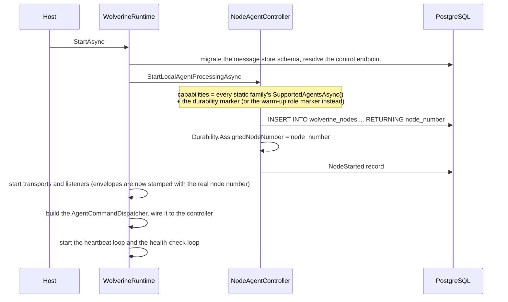
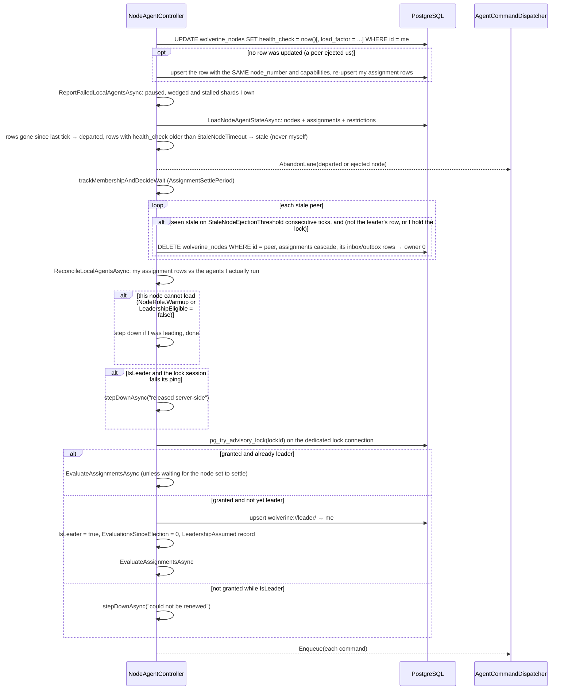
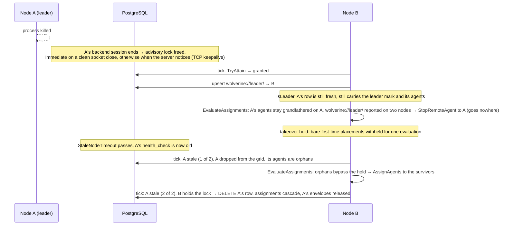
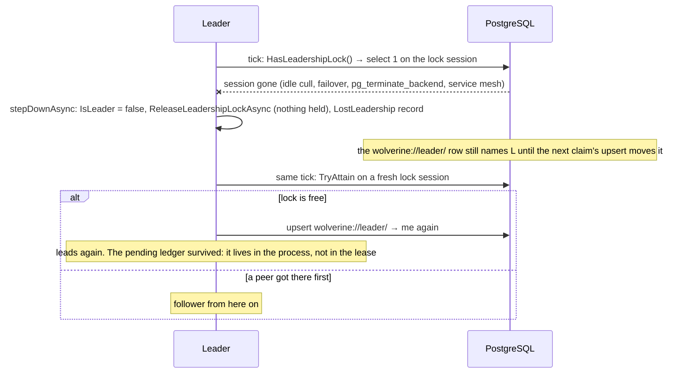
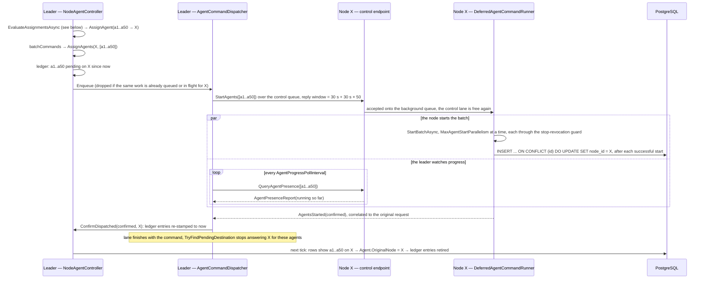
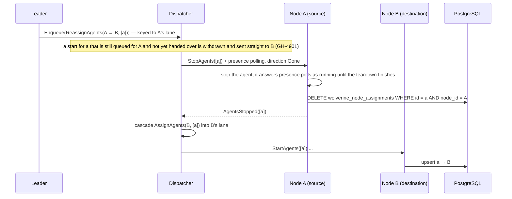
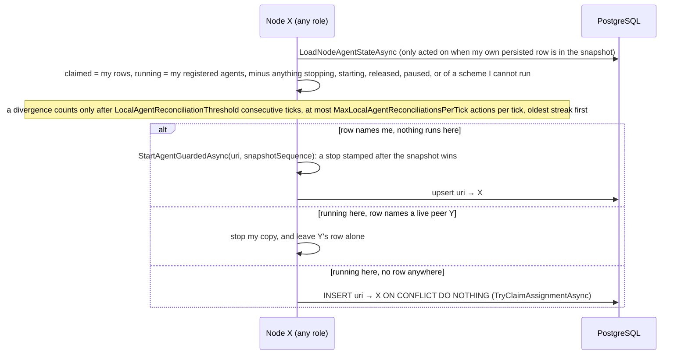
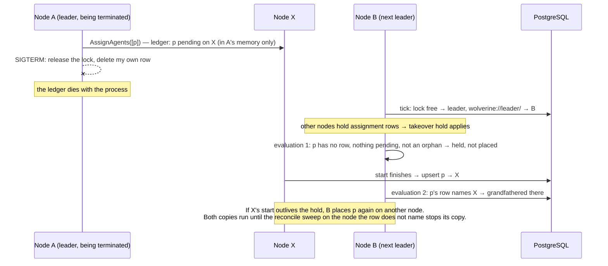

# Leadership and Agent Distribution Internals

::: info
This page is a design-level description of how a `Balanced` Wolverine cluster elects a leader and distributes
stateful agents today, written for people who need to reason about the mechanism -- to troubleshoot a cluster, to
write an external monitor against the node tables, or to change the mechanism itself. The operator-facing
knobs are documented in [Troubleshooting and Leadership Election](leadership-and-troubleshooting) and
[Subscription/Projection Distribution](marten/distribution); this page explains the moving parts behind them.
The sequence diagrams describe the PostgreSQL store. The other stores share the same controller and differ
only in the lock primitive, which is tabulated [at the end](#how-each-store-implements-the-leadership-lock).
:::

## The pieces

| Piece | Where | Role |
|---|---|---|
| `NodeAgentController` | `src/Wolverine/Runtime/Agents/NodeAgentController*.cs` | One per process. Runs the health-check tick, the election, stale-node ejection, the node-local sweeps, and -- on the leader -- the assignment evaluation |
| Heartbeat loop | `WolverineRuntime.writeHeartbeats` | Only ever writes this node's heartbeat. Deliberately separate from everything else so no amount of agent work can starve it (GH-3604) |
| Health-check loop | `WolverineRuntime.executeHealthChecks` | Calls `DoHealthChecksAsync` every `HealthCheckPollingTime` and hands whatever commands come back to the dispatcher. Never waits for them |
| `AgentCommandDispatcher` | `AgentCommandDispatcher.cs` | Executes the leader's commands on a persistent lane per destination node: serial within a lane, concurrent across lanes. Holds the "is a start still on its way to node X?" fact the leader's ledger consults |
| Pending-assignment ledger | `NodeAgentController.EvaluateAssignments.cs` | Leader-local, in-memory record of starts and moves dispatched but not yet visible as assignment rows. Dies with the process |
| `DeferredAgentCommandRunner` | `DeferredAgentCommandRunner.cs` | On the receiving node: takes a batched start or stop off the serial control lane and runs it in the background, replying when the work has actually finished |
| `AssignmentGrid` | `AssignmentGrid*.cs` | The leader's picture of nodes and agents for one evaluation, and the distribution strategies the agent families call |
| `IAgentFamily` | `IAgentFamily.cs` | A scheme of agents (`event-subscriptions://`, `wolverinedb://`, exclusive listeners, ...). Enumerates its agents and chooses a distribution strategy |
| `wolverine_nodes` | PostgreSQL | One row per live process: `id` (node id), `node_number` (serial), `uri` (control endpoint), `capabilities`, `health_check`, `version`, and `load_factor` when capacity-aware assignment is on |
| `wolverine_node_assignments` | PostgreSQL | **One row per agent**, ever: `id` is the agent URI, `node_id` is its owner, with `ON DELETE CASCADE` from `wolverine_nodes`. The row `wolverine://leader/` names the leader |
| Advisory lock | PostgreSQL session | `pg_try_advisory_lock(<hash of the schema name>)` on a dedicated connection. Whoever holds it is the leader |
| `wolverine_node_records` | PostgreSQL | Append-only diagnostic log: `NodeStarted`, `LeadershipAssumed`, `LeadershipLost`, `DormantNodeEjected`, `AssignmentChanged`, ... |

Two facts about the schema shape everything below:

* **The assignment table can only ever name one owner per agent.** `AddAssignmentAsync` is a last-writer-wins
  upsert, so a second copy of an agent is invisible to the table; it never shows two owners. What keeps ownership
  single is the leader's ledger while a start is in flight, and the node-side reconcile sweep afterwards.
* **A node writes its own assignment row, after it has started the agent.** The leader never writes an assignment
  row except its own `wolverine://leader/` row. So between "the leader decided" and "the node's row landed" the
  agent looks unplaced to anyone reading the table, and that window is what most of the machinery exists to cover.

## The clocks

| Setting | Default | What it paces |
|---|---|---|
| `FirstHealthCheckExecution` | 3 s | Delay before the first heartbeat and the first health check |
| `HealthCheckPollingTime` | 10 s | Both loops: the heartbeat write and the health-check tick |
| `StaleNodeTimeout` | 1 min | A peer whose `health_check` is older than this is dropped from the grid on sight |
| `StaleNodeEjectionThreshold` | 2 | Consecutive ticks a peer must read stale before its row is deleted |
| `CheckAssignmentPeriod` | 30 s | The ledger's TTL backstop (`2 ×`) and the Solo-mode start loop. The Balanced health check does **not** use it |
| `AssignmentSettlePeriod` / `MaxAssignmentSettleTime` / `AssignmentSettleNodeCount` | 0 / 1 min / 0 | Optional: hold every assignment pass while nodes keep joining |
| `LeaderTakeoverHoldEvaluations` | 1 | Evaluations a new leader spends not placing agents that are running nowhere, when it inherits a cluster with assignments |
| `LeaderColdStartHoldEvaluations` | 1 | Same, for the first node of a cold cluster, when the wave is bigger than `AgentStartBatchSize` |
| `AgentStartBatchSize` | 50 | Chunk size for `AssignAgents`, `StopRemoteAgents` and `ReassignAgents` |
| `MaxAgentStartParallelism` | 10 | Concurrent starts (and stops) inside one batch on the receiving node |
| `AgentProgressPollInterval` / `AgentProgressStallTimeout` | 10 s / 5 min | How often the dispatcher asks a node which agents are running, and how long with no new confirmation before it gives up on a batch |
| `LocalAgentReconciliationThreshold` / `MaxLocalAgentReconciliationsPerTick` | 3 / 50 | The node-side sweep: ticks a divergence must persist before it is acted on, and actions per tick |
| `LeadershipEligible` / `NodeRole` | true / Serving | Whether this node may hold the lock at all |
| `CapacityAwareAssignment` / `NodeOverloadThreshold` / `OverloadShedBatchSize` | false / 90 / 1 | Load advertisement and shedding |

## Node startup

Registration happens before the transports start (GH-4734): a node must own its node number before it claims
inbox rows, or the orphan sweep on another node releases those rows as belonging to a departed owner.

## The health-check tick

Every node runs this every `HealthCheckPollingTime`, whatever its role. Only the last third is leader work.

Details that matter when reading this:

* **The tick never considers itself stale** (GH-2682): it just wrote its own heartbeat, and a lagging read must not
  fold it into the stale set.
* **Routing to a stale node stops on the first sighting**; only the *delete* waits for the threshold. The delete is
  what releases the dead node's envelopes and, through the cascade, its assignment rows.
* **Leader protection**: a follower that sees the leader's row as stale leaves it alone. The freed lock lets the
  follower become leader through the normal path, and the confirmed new leader ejects the old row a tick later.
* **The lock is re-attained on every tick**, including by the sitting leader. On PostgreSQL the client short-circuits
  when it already holds the lock (session locks stack, and a stacked lock would survive a single release). On
  the lease backends this call *is* the renewal.
* **`HasLeadershipLock` is a real round trip** on PostgreSQL: `select 1` on the lock session with a two-second
  timeout. A failure clears the held ids and disposes the connection. If the lock connection is busy with another
  operation at that moment, the tick reports the last known state rather than a false negative (GH-4261).

## Failover when the leader dies

So leadership moves within about one tick of the session dying, but the dead leader's *agents* move only once its
row ages past `StaleNodeTimeout`. On the lease-based stores the order is reversed: the node row goes stale after
one minute, the lock only expires after its five-minute lease.

## Stepping down

The same `stepDownAsync` runs when a node's eligibility is revoked under a running cluster, and when the renewal
of a lease fails on the lease-based stores. Two consequences worth knowing:

* The pending-assignment ledger is cleared by process death only. A leader that steps down and is re-elected in
  the same process still remembers the starts it dispatched.
* Stepping down does not clear the `wolverine://leader/` row. `stepDownAsync` stops a local leader agent only if
  one is registered, and nothing registers one, so the table keeps naming the ex-leader until the next claim's
  upsert moves the row. `WolverineNode.IsLeader()` reads that row.
* The claim itself is an unconditional upsert on a pooled connection, made after the lock was granted. If the
  lock session dies in between and a peer attains and claims first, the late claim moves the row back to a node
  that is about to step down, and the real leader runs without the mark until the next election. Leader-pinned
  agents are then placed by that row. A leader re-upserting its row on every renewed tick would close this; the
  model on the fork checks that repair.
* If every eligible node is gone and only ineligible nodes remain, nobody leads, nothing is assigned, and the dead
  leader's row is **never ejected**: leader protection reserves that for a lock holder, and an ineligible node never
  holds the lock. The dead leader's envelopes stay owned by it until an eligible node joins.

## One assignment, end to end

What the leader does inside `EvaluateAssignmentsAsync`, in order:

1. Build the grid from the snapshot: every non-stale node with its capabilities, assignment rows and load; every
   agent each family knows about. The leader stamps `IsOverloaded` and `IsAcceptingAgents` per node when
   capacity-aware assignment is on.
2. Per family (durability last, so it can follow the event-subscription placements): apply restrictions (an
   operator's pin or pause outranks everything), project the pending ledger onto the grid (an in-flight start
   counts as a placement on its destination, so the distribution balances around it), then let the family
   distribute.
3. For every agent, compare where it is (`OriginalNode`, from the rows) with where it should be
   (`AssignedNode`) and with what is pending, and emit nothing, `AssignAgent`, `ReassignAgent` or
   `StopRemoteAgent`.
4. Apply the takeover or cold-start hold: a bare first-time `AssignAgent` for an agent with no row and nothing
   pending is withheld for the hold's evaluations, unless the agent is an orphan of a node that left.
5. Emit a `StopRemoteAgent` for the older copy of any agent two nodes' rows both claim (GH-2602). On the
   one-row-per-agent stores this only ever fires for `wolverine://leader/` during a leader change.
6. Update the ledger from what is being dispatched, record `AssignmentChanged`, and chunk the commands per
   destination into batches of `AgentStartBatchSize`.

The ledger holds an agent on its destination for as long as the dispatcher says the command is still queued or
executing. Only after that does the TTL backstop (`2 × CheckAssignmentPeriod`) apply, which covers the gap between
the command finishing and the node's row turning up in a snapshot. A re-drive after expiry is never a bare start
somewhere else: with the pending node known, the grid turns it into a stop-then-start.

## Moving an agent

The stop runs in the *source's* lane so it lands behind any start still queued there for the same node, and the
start half is only ever cascaded for agents confirmed gone from the source. Both are the single-copy invariant: an
agent is never started on B while a copy may still be running on A.

## The node-side reconcile sweep

The leader cannot see two kinds of divergence: a row with no runner looks assigned, and a runner with no row is
invisible. Every node heals its own on every tick (GH-3987, GH-4407).

This sweep is what turns a transient duplicate into a healed one on the one-row stores: whichever copy's node
wrote the row last keeps it, and the other node sees "the row names a live peer" three ticks in a row and stops.

## Leader change during a rolling deploy

The case the ledger cannot cover on its own, and the reason the takeover hold exists (GH-4897).

The hold is a timing heuristic, one snapshot cycle long. It closes the common case; the sweep is what closes the
rest. The [formal models](https://github.com/mlh758/wolverine/tree/p-models/formal) on the fork check exactly this
boundary.

## Which strategy places which agents

| Strategy | Used by | Shape |
|---|---|---|
| `RunOnLeader` | leader-pinned listeners, the main store's durability agent on single-database stores | The leader, full stop |
| `DistributeEvenly` | exclusive listeners, dynamic listeners, sticky PostgreSQL queue listeners | Ceiling `⌈n / receiving nodes⌉`, detach above it, fill to the floor, remainder to the first non-leader. Warm-up and non-accepting nodes receive nothing. Capability is not consulted |
| `DistributeEvenlyWithBlueGreenSemantics` | event subscriptions on a single-database store | `DistributeEvenly` when every node declares the same capabilities; otherwise each agent goes only to a node that declares it, fewest-candidates first, load as a preference. A running agent keeps its node until the ceiling moves it. Warm-up nodes get only what no serving node declares |
| `DistributeByGroupAffinity` | event subscriptions on a multi-database store (sharded tenancy, database per tenant) | All of one database's agents stay together. Groups are placed largest first; the incumbent is the node already running most of the group (GH-3987); a group that fits nowhere stays put unless a strictly lighter accepting node exists (GH-4999); at most `OverloadShedBatchSize` groups move off an overloaded node per evaluation |
| `DistributeEvenlyWithAffinity` | the durability agents of a multi-database store | Each database's durability agent goes next to that database's event-subscription agents when there are any, otherwise evenly over the nodes that advertise the durability marker |
| `SingularAgent` | one-per-cluster agents such as recurring messages | First non-leader serving node, else any serving node; never a warm-up node |

Common rules: a pinned agent stays where it is pinned; a paused agent is detached everywhere; shedding only
happens when another node can accept the work; an agent whose capability no live node declares stays unassigned
and is logged.

## How each store implements the leadership lock

| Store | Primitive | Freed when the holder dies | `HasLeadershipLock` checks |
|---|---|---|---|
| PostgreSQL | `pg_try_advisory_lock(hash of schema name)` on a dedicated, `application_name`-tagged connection | The backend session ends | A real `select 1` on the lock session |
| SQL Server | `sp_getapplock` (session owner, 1 s timeout) on a dedicated connection | The session ends | A real `select 1` |
| MySQL | `GET_LOCK('wolverine_<hash>', 0)` | The session ends | A real `select 1` |
| Oracle | `SELECT ... FOR UPDATE NOWAIT` on a `WOLVERINE_LOCKS` row, held in an open transaction on its own connection | The session's transaction rolls back | A real `select 1 from dual` |
| SQLite | A row in `wolverine_locks` with a two-minute lease, refreshed on every tick | Nobody frees it; the next contender sweeps it after the lease | The connection only, not the row |
| RavenDB | A compare-exchange value with a five-minute lease, renewed by CAS on every tick | Nobody frees it; a contender takes over after the lease | The local copy's expiry only |
| Cosmos DB | A lock document with a five-minute lease, renewed with an ETag on every tick | Nobody frees it; a contender takes over after the lease | The local copy's expiry only |

On the session-lock stores a dead leader is replaced within a tick of the session dying. On the lease stores the
old lease has to run out first, and the leases are longer than `StaleNodeTimeout`, so the dead leader's row is
ejected before its lock can be taken. With multiple tenant databases, the lock and every node and assignment row
live in the **main** store only.

## Known limitations

These are properties of the current design, listed here so a change can be measured against them:

* The pending-assignment ledger is leader-local and in memory. A leader change loses it; the takeover hold covers
  one snapshot cycle, and the reconcile sweep heals what slips past.
* The assignment row is written by the node after the start, so the table cannot express "assigned but not yet
  running", and it cannot show two owners. An observer reading the table alone sees an immaculate picture during a
  duplicate.
* `AddAssignmentAsync` is last-writer-wins. A node re-registering after a partition re-upserts its rows over
  whatever a peer wrote while it was away; the sweep sorts it out afterwards.
* Leader protection has no fallback when no eligible node is left: a dead leader's row survives until an eligible
  node joins, and the `wolverine://leader/` row keeps naming the last leader.
* On the lease stores `HasLeadershipLock` never consults the server, and lease expiry compares application clocks
  across machines.
* On SQLite the lock row's refresh and release are not owner-scoped.
